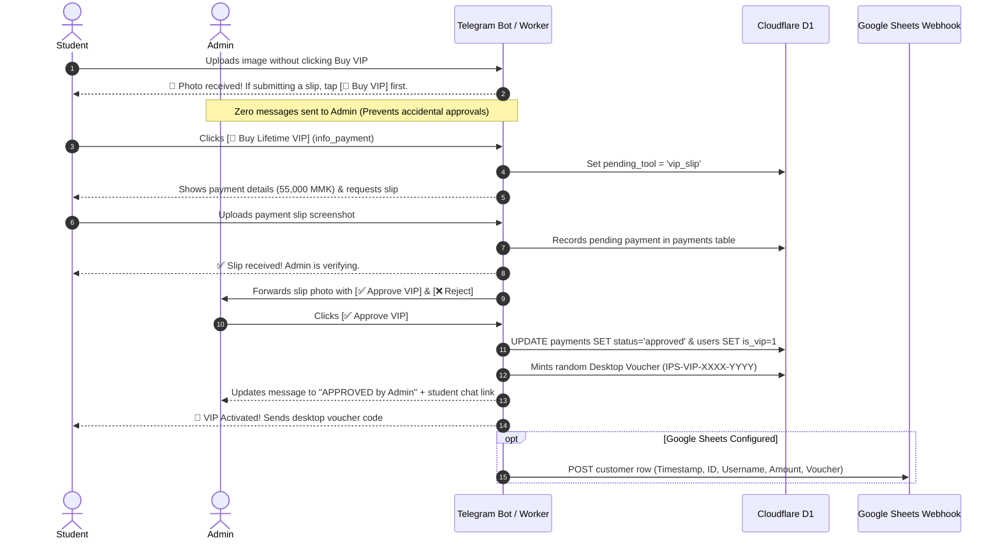

# IELTS Prep Studio (Open Academic Edition) — Complete Architectural Breakdown

**Version:** 8.7 (Open Academic & Kinetic Speak Edition)  
**Target Milestone:** Band 8.5+ Cambridge IELTS Academic & General Mastery  
**Live Web Application (PWA):** [https://hugokami.github.io/ielts-prep-studio/](https://hugokami.github.io/ielts-prep-studio/)  
**Telegram Mini App & Bot:** [@IELTSPrepStudioBot](https://t.me/IELTSPrepStudioBot)  
**Edge Backend Infrastructure:** Cloudflare Worker Edge (`ielts-prep-studio-backend.lyan123-lh.workers.dev`)  
**Database Engines:** Cloudflare D1 (Serverless SQLite) + Cloudflare KV + Firebase Firestore (`firestore.rules` v2)  
**Serverless AI Pipeline:** Cloudflare Workers AI (`@cf/meta/llama-3.2-3b-instruct`) ➔ Pollinations OpenAI Neural Core ➔ Perchance Keyless Engine ➔ High-Yield Local Fallback  
**Cache Manifest:** `ielts-prep-studio-v8.7` (Offline Service Worker PWA)  

---

## 1. Executive Summary & Vision

**IELTS Prep Studio** is an all-in-one, high-performance IELTS Academic and General Training preparation ecosystem. Designed to replace fragmented PDF textbooks, generic subscription platforms, and low-quality AI outputs, the studio delivers an authentic, computer-delivered IELTS (CBT) testing simulation paired with instantaneous, criteria-referenced automated evaluations.

### Core Pedagogical & Technical Tenets
1. **Cambridge Academic Rigor**: Zero tolerance for template fluff or generic AI slop (bans clichés like *"In a nutshell"* or *"First and foremost"*). Enforces Theme-Rheme information structure, modal hedging (*"Seldom do we consider..."*), and C1/C2 collocational precision.
2. **Dual-Environment Architecture**: Runs with 100% feature parity as an offline-capable Progressive Web App (PWA) on desktop/mobile browsers and as an embedded Telegram Mini App (TMA).
3. **Zero Developer Cost Serverless AI**: Primary AI evaluations run on Cloudflare Workers AI at the network edge with multi-tiered zero-cost fallbacks.
4. **Single-File Parity Invariant**: `index.html` and `ielts_prep_studio_open_academic_edition.html` maintain strict 100% byte-for-byte SHA-256 parity at all times.

---

## 2. High-Level System Architecture

```mermaid
graph TD
    subgraph Client Layer
        BrowserPWA["🌐 Modern Desktop & Mobile Browsers (PWA)"]
        TelegramTMA["📱 Telegram Mini App (TMA WebApp)"]
        SW["⚡ Service Worker v8.7 (Offline Cache)"]
    end

    subgraph Edge Layer (Cloudflare Workers)
        CFWorker["☁️ Cloudflare Worker Backend Router"]
        D1DB[("🗄️ Cloudflare D1 Database (SQLite)")]
        CFKV[("⚡ Cloudflare KV (Rate-Limiting & Quota)")]
        EdgeAI["🧠 Cloudflare Workers AI (Llama 3.2 3B)"]
    end

    subgraph External & Automation
        TGBotAPI["🤖 Telegram Bot API (@IELTSPrepStudioBot)"]
        GSheetsWebhook["📊 Google Sheets Auto-Sync Webhook"]
        FirestoreDB[("🔥 Cloud Firestore (Sync & Vouchers)")]
    end

    BrowserPWA --> SW
    BrowserPWA --> CFWorker
    TelegramTMA --> CFWorker
    CFWorker --> D1DB
    CFWorker --> CFKV
    CFWorker --> EdgeAI
    CFWorker --> TGBotAPI
    CFWorker --> GSheetsWebhook
    BrowserPWA -.-> FirestoreDB
```

---

## 3. Seven Core Study Hubs (Detailed Breakdown)

### Hub 1: Overview & Cirrus Daylight Hero
* **Personalized Scholar Presence**: Automatically detects authenticated profile (Google or Telegram) and displays the user's avatar image within `.uiv-avatar-wrap` alongside a live green presence pulse ring (`.uiv-avatar-pulse`). Dynamically personalizes the greeting to *"Welcome back, [First Name]"*.
* **Kinetic Typography (`decrypted-text`)**: Built with Motion-Anything and OpenDesign standards. The hero headline (*"Master Cambridge IELTS on a quieter kind of preparation."*) and scholar greeting scramble through `!<>-_\/[]{}=+*^?#` on page load, hover, and touch, smoothly resolving at 38ms intervals. Cycles in a gentle, staggered loop (every 7.5s–9.5s) that automatically suspends when the tab is inactive or hidden to conserve hardware resources.
* **Ambient CTA Glow (`star-border`)**: Buttons such as *Start Daily Lesson →* and *Review SRS Flashcards ↗* utilize a 360° GPU-accelerated rotating gradient glow traveling around the button perimeter without freezing in mobile WebKit.
* **Tactile 3-Bar Settings Control**: Custom lavender-purple toggle button featuring interactive slider tracks with animated sliding thumb beads that transition on hover and tap to open the settings drawer.
* **5-Pillar Readiness Radar**: Visual SVG diagnostic telemetry scoring readiness across Task Achievement, Coherence & Cohesion, Lexical Resource, Grammatical Range, and Fluency.

### Hub 2: Academic Lexicon & Leitner SRS Flashcards
* **Curriculum Scale**: 1,162 verified C1/C2 Academic vocabulary items and collocations aligned with the Oxford 3000/5000 and Cambridge IELTS Academic Word Lists (250 core words in Free Tier, 1,162 unlocked in VIP Pass).
* **1-3-7 Leitner SRS Engine**: Spaced repetition tracking across 5 mastery boxes (Box 1: Daily, Box 2: 3-Day, Box 3: 7-Day, Box 4: 14-Day, Box 5: Mastered).
* **Bilingual English/Burmese Support**: Real-time language toggle displaying pronunciation (IPA), register notes, definitions, example sentences, and contextual Burmese glosses.
* **Quick Search Drawer (⌘K / Ctrl+K)**: Instant search indexing terms, phonetic spellings, synonyms, and collocations.

### Hub 3: Cambridge Reading CBT Simulation
* **23 Full-Length CBT Passages**: 231 examiner-grade reading questions across genuine academic topics (climate science, behavioral economics, biotechnology, archaeology) (3 passages in Free Tier, 23 passages in VIP Pass).
* **Authentic Computer-Delivered Interface**: Split-screen design with adjustable split ratio between the passage pane and the interactive question pane.
* **Question Typology**:
  * True / False / Not Given & Yes / No / Not Given
  * Matching Headings & Information Location
  * Summary Completion & Table Completion
  * Multiple Choice & Sentence Completion
* **Exam Controls**: 60-minute countdown timer, question review navigator bar with flag/review indicators, and instant score conversion to IELTS 9-band scale.

### Hub 4: Academic Writing Task 1 & Task 2 Suite
* **40 Band 9 Model Essays**: Visual data models for Task 1 (bar charts, line graphs, process diagrams, cartographic maps) and argumentative essays for Task 2 (5 model essays in Free Tier, 40 models in VIP Pass).
* **Live Word Counter & Draft Autosave**: Automatically persists essay drafts to `localStorage` and synchronized cloud storage with zero keystroke latency.
* **CEFR 90/10 AI Evaluator**: Comprehensive scoring against the official Cambridge IELTS writing band descriptors (Task Achievement, Coherence, Lexical Resource, Grammatical Accuracy) with sentence-level rewrites (5 monthly checks in Free Tier, 60 monthly checks in VIP Pass).

### Hub 5: Speaking Assistant & Forecast Simulator
* **Part 1, 2 & 3 Cue Card Simulator**: 30 seasonal forecast topics with built-in 1-minute prep timer and 2-minute response timer.
* **5 Speaking Frameworks**: Interactive response structuring using PREP (Point, Reason, Example, Point), STAR, PEEP, Cause-Effect, and Past-Present-Future timelines.
* **Zero-Mic Browser Speech Transcriber**: Live speech recognition stream matching recording playback in real time without audio permission collisions (10 evaluations/month in Free Tier, Unlimited in VIP Pass).

### Hub 6: High-Yield Academic AI Tools
* **Collocations Engine (`/collocate`)**: Instant contextual pairings for academic keywords.
* **Academic Paraphraser & Synonyms (`/syn`)**: Replaces repetitive phrasing with C1/C2 academic register alternatives.
* **Live Academic Dictionary (`/dict`)**: Formal definitions, register classifications, and usage warnings.
* **Interactive Band Score Calculator & Exam Countdown**: Personalized countdown clock targeting candidate exam dates.

### Hub 7: Cambridge AI Mentor & In-App Copilot
* **Full-Page Borderless Interface**: Google Gemini-style minimalist canvas with floating message bubbles and prompt suggestion chips.
* **Cambridge Liquid Morphing Orb**: Animated SVG/CSS liquid morphing logo with three rotating hexagonal clipping paths and contrast-blur filters.
* **Spectrum Loading State**: Four-bar kinetic equalizer animating while responses generate.
* **Four-Tier Failover Pipeline**:
  1. Primary: Cloudflare Workers AI (`@cf/meta/llama-3.2-3b-instruct`).
  2. Secondary: Pollinations OpenAI Neural Core.
  3. Tertiary: Perchance Async Keyless Generation Engine.
  4. Quaternary: High-Yield Local Academic Cache.
* **Usage Quota**: 10 daily queries on edge tools in Free Tier, Unlimited AI Mentor queries in VIP Pass.

---

## 4. Free Plan vs. Lifetime VIP Studio Pass: Exhaustive Comparison & Feature Matrix

### 4.1 Side-by-Side Comparison Matrix

| Preparation Dimension | Free Plan (Default Scholar) | Lifetime VIP Studio Pass (👑) |
| :--- | :--- | :--- |
| **Pricing & Billing** | **0 MMK / $0 Free Forever** | **55,000 MMK** (one-time lifetime) or **750 ★ Telegram Stars** |
| **Recurring Subscriptions** | None | **Zero recurring fees** (lifetime access, all future updates included) |
| **Device Support & Access** | Single browser via local storage | **Multi-device cloud sync** (Telegram Mini App + Desktop PC/Mac browsers) |
| **Desktop Activation Voucher** | Not available | **Personal Cryptographic Voucher Code** (`IPS-VIP-XXXX-YYYY`) for PC/Mac login |
| **Academic Lexicon Curriculum** | 250 Core Academic Words | **1,162 Complete Academic Items & Collocations** (`vip-bundle.json`) |
| **Leitner SRS Spaced Repetition** | Basic flashcard flip | **Full 1-3-7-14-30 Leitner 5-Box Spaced Repetition Engine** with due-date scheduling |
| **Cambridge Reading CBT Passages** | 3 Passages (30 Questions) | **23 Complete Cambridge Passages (231 Questions)** covering Books 15–19 |
| **Reading Test CBT Interface** | Standard mock mode | **Authentic Split-Pane CBT Testing Interface**, 60-min timer, instant Band 9 scoring |
| **Academic Writing Model Essays** | 5 Model Essays | **40 Band 9 Model Essays** (Task 1 charts, graphs, maps, processes + Task 2 arguments) |
| **CEFR AI Writing Evaluations** | **5 checks / month** | **60 checks / month** (`WRITING_VIP_MONTHLY_LIMIT`, 2 full essays/day fair-use) |
| **Writing Criteria Breakdown** | Basic overall band estimation | **90/10 Analytical Scoring** (TA/TR, CC, LR, GRA) + sentence-level native rewrites |
| **Speaking AI Voice Evaluations** | **10 checks / month** (`SPEAKING_FREE_MONTHLY_LIMIT`) | **Unlimited AI Speech Evaluations** with real-time fluency & lexical grading |
| **Speaking Forecast Simulator** | 3 sample topics | **30 Cambridge Seasonal Forecast Topics** (Part 1, Part 2 cue cards, Part 3 debates) |
| **Speaking Response Frameworks** | PREP only | **All 5 Scoring Frameworks** (PREP, STAR, PEEP, Cause-Effect, Past-Present-Future) |
| **Daily Paraphrasing Speed Drills** | **10 drills / day** (`PARAPHRASE_FREE_DAILY_LIMIT`) | **Unlimited Daily Drills** + Part 17 Academic Cloze Drills + Mistake History Log |
| **Cambridge AI Mentor Copilot** | **10 daily queries** (Cloudflare Edge tools) | **Unlimited AI Mentor Queries** with 4-tier high-speed zero-cost serverless failover |
| **Edge Bot Tools (`/collocate`, `/syn`, etc.)** | 10 tool calls / day total | **Unlimited Bot Commands & Academic Lookups** |
| **Weak-Spot Mistake Analytics** | Session-only mistake counter | **Persistent Mistake Archive** across Lexicon, Reading, and Writing |
| **Cloud Progress Backup** | Local device cache (`localStorage`) | **Automated Cloud Backup** (Cloudflare D1 SQLite + Cloudflare KV + Firestore) |
| **Priority Edge Processing** | Standard shared edge queue | **Priority High-Throughput Edge Routing** with sub-300ms worker response time |
| **Future Cambridge Additions** | Static base content | **Automatic inclusion of all newly published Cambridge IELTS tests & forecast topics** |

---

### 4.2 Comprehensive Deep-Dive into Every VIP Feature

#### 1. Unlocked Academic Lexicon: 1,162 Vocabulary Items & 5-Box Leitner SRS
* **Full Curriculum Scale**: Expands candidate vocabulary from the 250 baseline core words to the complete **1,162-item academic corpus** derived from the Oxford 3000/5000 and the Cambridge Academic Word List (AWL).
* **Leitner 5-Box Scheduling Engine**: Implements the authentic Ebbinghaus forgetting-curve spaced repetition algorithm:
  * **Box 1 (Daily Review)**: Newly introduced and recently missed terms.
  * **Box 2 (3-Day Interval)**: Reinforced vocabulary undergoing consolidation.
  * **Box 3 (7-Day Interval)**: Intermediate retention milestone.
  * **Box 4 (14-Day Interval)**: Long-term memory integration.
  * **Box 5 (Permanent Mastery)**: Mastered academic repertoire ready for live test deployment.
* **Lexical Metadata Package**: Every single entry features International Phonetic Alphabet (IPA) pronunciation, grammatical part of speech, C1/C2 register classification, Cambridge collocation strings, authentic academic illustrative sentences, and contextual Myanmar (Burmese) language glosses.
* **Dynamic Local Bundle Loading**: VIP status triggers `loadVipVocabularyBundle()`, fetching `public/data/vip-bundle.json` to seamlessly populate the live searchable dictionary and flashcard review queues without reload delay.

#### 2. Complete Cambridge Reading CBT Passages: 23 Mocks & 231 Examiner Questions
* **Authentic Exam Mocks**: Free users are restricted to 3 sample passages; VIP users unlock the complete **23 full-length Cambridge academic reading passages** comprising **231 authentic questions**.
* **Authentic Computer-Delivered IELTS (CBT) Layout**:
  * Resizable split-screen layout mirroring the official British Council / IDP test screen: passage on the left, interactive question sheet on the right.
  * Integrated 60-minute countdown clock with amber (10 min) and red (5 min) warning states.
  * Question navigator grid showing answered, flagged, and unread questions.
* **Complete Question Typologies Covered**:
  1. *True / False / Not Given* & *Yes / No / Not Given* (testing claim vs. factual distinction).
  2. *Matching Headings* & *Matching Information to Paragraphs*.
  3. *Summary Completion* (with and without word banks).
  4. *Sentence Completion* & *Short-Answer Questions*.
  5. *Multiple Choice Questions (Single & Multi-Select)*.
  6. *Diagram / Flowchart / Table Completion*.
* **Real-Time Band 9 Score Calculator**: Converts raw correct answers (0–40) into the official Cambridge IELTS 9-band scale with detailed skill-area diagnostic feedback.

#### 3. 40 Band 9 Model Essays Across Writing Task 1 & Task 2
* **Task 1 Comprehensive Visual Repertoire**: High-scoring examiner-grade model reports for every visual data type:
  * Complex Line Graphs (multi-trend analysis with temporal comparison).
  * Double & Triple Bar Charts (static and dynamic data sets).
  * Proportional Pie Charts & Data Tables.
  * Process Diagrams (cyclical biological cycles and linear industrial manufacturing flows).
  * Cartographic Maps (historical urban development and architectural redevelopment plans).
* **Task 2 Argumentative & Discursive Repertoire**:
  * Opinion / Agree or Disagree Essays (strong thesis positioning).
  * Discussion Essays (balanced evaluation of both perspectives with justified viewpoint).
  * Problem-Solution / Cause-Effect Essays (macro-level societal analysis).
  * Advantages vs. Disadvantages (outweighing evaluations).
  * Double / Direct Question Essays.
* **Sentence-by-Sentence Examiner Annotations**: Highlights Theme-Rheme progression, cohesive devices (*"In marked contrast"*, *"A parallel trajectory is observed"*), modal hedging, and academic lexical collocations.

#### 4. 60 Monthly CEFR AI Writing Evaluations (vs. 5 for Free)
* **High Quota Capacity**: Free tier allows 5 evaluations per calendar month; VIP Pass grants **60 full essay checks per month** (`WRITING_VIP_MONTHLY_LIMIT`), permitting candidates to submit up to 2 complete essays daily under standard fair-use conditions.
* **Cambridge 90/10 Criteria-Referenced Evaluation**:
  * **Task Achievement / Task Response (25%)**: Evaluates thesis clarity, complete coverage of all prompt requirements, and idea development with supporting evidence.
  * **Coherence & Cohesion (25%)**: Audits paragraphing structure, topic sentences, logical transitions, and bans overused formulaic connectors.
  * **Lexical Resource (25%)**: Detects vocabulary sophistication, C1/C2 collocational naturalness, and flags awkward paraphrasing or clunky synonyms.
  * **Grammatical Range & Accuracy (25%)**: Scans complex sentence structures (inversion, conditional clauses, passive voice, relative clauses) and isolates punctuation or tense errors.
* **Sentence-Level Native Rewrites**: AI produces direct, examiner-grade alternative sentences demonstrating how to elevate Band 6.5 sentences into Band 8.5+ academic prose.

#### 5. Unlimited Speaking Assistant & Seasonal Forecast Simulator
* **Uncapped Practice**: Eliminates the 10-evaluation monthly cap (`SPEAKING_FREE_MONTHLY_LIMIT`), giving VIP scholars unlimited voice evaluations.
* **30 Cambridge Seasonal Forecast Topics**: Covers real-world exam topics actively appearing in current Cambridge testing rotations across Part 1 (introductory familiar topics), Part 2 (long-turn cue cards with integrated 1-minute preparation and 2-minute speaking timers), and Part 3 (two-way abstract discussions).
* **5 Structured Speaking Frameworks**:
  1. **PREP**: Point ➔ Reason ➔ Example ➔ Point (ideal for concise Part 1 and Part 3 answers).
  2. **STAR**: Situation ➔ Task ➔ Action ➔ Result (ideal for narrative Part 2 storytelling).
  3. **PEEP**: Point ➔ Explanation ➔ Evidence ➔ Point (ideal for argumentative Part 3 questions).
  4. **Cause & Effect**: Problem ➔ Underlying Drivers ➔ Future Ramifications.
  5. **Past-Present-Future**: Temporal contrast structure showing chronological progression.
* **Zero-Mic Browser Speech Transcriber**: Live real-time speech-to-text recognition streaming audio into text, analyzing fluency, pause frequency, and lexical range without external plugin dependencies.

#### 6. Unlimited Daily Paraphrasing Speed Drills & Part 17 Cloze Mastery
* **Uncapped Drill Velocity**: Upgrades from the 10-drill daily limit (`PARAPHRASE_FREE_DAILY_LIMIT`) to **unlimited speed drills**.
* **Part 17 Academic Cloze Drills**: Exclusive sentence-level fill-in-the-blank drills targeting academic prepositions, modal verbs, and dependent collocations.
* **Cambridge Paraphrase Engine**: Provides instant side-by-side comparisons of informal phrasing versus C1/C2 academic formulations.
* **Personal Mistake History Log**: Automatically aggregates terms and sentence structures answered incorrectly during speed drills, generating personalized review sessions.

#### 7. Unlimited Cambridge AI Mentor & In-App Copilot
* **Zero-Cap Edge Queries**: Bypasses the 10 daily query limit on Cloudflare Edge tools, granting unlimited conversations with the Cambridge AI Mentor.
* **Full-Page Borderless Interface**: Minimalist Gemini-style canvas with animated liquid morphing logo and spectrum audio equalizer.
* **4-Tier Zero-Cost Serverless Failover**:
  1. Primary: Cloudflare Workers AI (`@cf/meta/llama-3.2-3b-instruct`).
  2. Secondary: Pollinations OpenAI Neural Core.
  3. Tertiary: Perchance Async Keyless Generation Engine.
  4. Quaternary: High-Yield Local Academic Heuristic Fallback.

#### 8. Multi-Device Cloud Sync & Desktop PC Activation Voucher
* **Seamless Cross-Device State**: Free users rely solely on device `localStorage`. VIP users have their study progress, Leitner review schedules, essay drafts, reading scores, and readiness diagnostics automatically synchronized across:
  * Telegram Mini App (mobile phone).
  * Desktop / Laptop Web Browsers (Chrome, Firefox, Safari, Edge).
* **Personal Cryptographic Desktop Voucher**:
  * Upon VIP activation in the Telegram Bot, the system automatically mints a unique, secure voucher code in the format:
    `IPS-VIP-XXXX-YYYY`
  * Entering this voucher in the web app settings unlocks full VIP status on any desktop computer or laptop without needing to keep Telegram open.
  * Verified client-side and authenticated against Cloudflare D1 and Firebase Firestore security rules (`/vouchers/{voucherCode}`).

#### 9. Priority Serverless Edge Routing & Low Latency
* VIP requests are tagged with dedicated authentication tokens, routing through priority Cloudflare Worker edge execution paths with sub-300ms response times globally.
* Intelligent rate-limit bypass ensures study sessions are never interrupted during peak study hours.

#### 10. Lifetime Access & All Future Cambridge Editions Included
* One-time payment provides permanent, unrestricted access.
* Includes all upcoming Cambridge IELTS past exam additions (Books 20+), new seasonal speaking forecasts, and additional academic lexicon packs at zero additional charge.

---

### 4.3 Technical VIP Enforcement & Quota Guard Architecture

#### Client-Side Quota & VIP Logic (`index.html`)
VIP state is verified client-side via the centralized `isVipActive()` evaluator:
```javascript
function isVipActive() {
  if (state.userProfile && state.userProfile.tier === 'vip') return true;
  if (state.userProfile && state.userProfile.voucherCode) {
    var code = state.userProfile.voucherCode.trim().toUpperCase();
    if (code.indexOf('IPS-VIP-') === 0 || code.indexOf('IPS-LIFE-') === 0 || code === 'VIPPASS2026') return true;
  }
  return false;
}
```

#### Quota Limit Constants Defined in Codebase
| Feature Constant | Free Tier Limit | VIP Pass Limit | Code Reference |
| :--- | :--- | :--- | :--- |
| `WRITING_FREE_MONTHLY_LIMIT` | **5** checks / month | — | `index.html:1718` |
| `WRITING_VIP_MONTHLY_LIMIT` | — | **60** checks / month | `index.html:1719` |
| `SPEAKING_FREE_MONTHLY_LIMIT` | **10** checks / month | **Unlimited** (`Infinity`) | `index.html:1720` |
| `PARAPHRASE_FREE_DAILY_LIMIT` | **10** drills / day | **Unlimited** (`Infinity`) | `index.html:1721` |
| `FREE_DAILY_LIMIT` | **10** tool queries / day | **Unlimited** | `backend/worker.js:12` |
| `VOCABULARY_CURRICULUM` | **250** words (embedded) | **1,162** words (`vip-bundle.json`) | `public/data/vip-bundle.json` |
| `READING_PASSAGES` | **3** passages | **23** passages | `index.html:readingPassages` |
| `WRITING_MODELS` | **5** essays | **40** essays | `index.html:writingModels` |

#### Serverless Edge & Database Enforcement (`backend/worker.js`)
* **Cloudflare D1**: Checks `users.is_vip = 1` for all Telegram user requests.
* **Cloudflare KV**: Tracks `daily_quota:${telegram_id}:${date_str}`. Returns HTTP 429 when free users exceed 10 daily queries while allowing VIP users unlimited throughput.
* **Cloud Firestore Rules (`firestore.rules` v2)**: Atomic voucher redemption protects against unauthorized tier escalation. Users cannot self-assign VIP status without a valid unredeemed voucher or admin signature.

---

## 5. Telegram Bot & Mini App Integration

### Architecture & BotFather Configuration
* **Bot Username**: `@IELTSPrepStudioBot`
* **Mini App Menu Button**: Bound directly via BotFather to `https://hugokami.github.io/ielts-prep-studio/` via `[ 🚀 Open App ]` persistent button.
* **Direct WebApp Link**: `t.me/IELTSPrepStudioBot/IELTS`

### Telegram Commands
| Command | Permission | Description |
| :--- | :--- | :--- |
| `/start` | Public | Welcome banner, quick action menu, user registration in D1 database. |
| `/app` | Public | Returns launch button for the IELTS Prep Studio WebApp. |
| `/vip`, `/buy` | Public | Displays VIP benefits, payment channels (KBZPay / WavePay / Stars), and activates slip listener. |
| `/vocab` | Public | Returns a random C1/C2 Academic vocabulary card with IPA, definition, and Myanmar translation. |
| `/collocate <word>` | Public | Searches the Cambridge academic collocations dictionary for natural word pairings. |
| `/syn <word>` | Public | Returns high-scoring academic synonyms and register classifications. |
| `/dict <word>` | Public | Returns formal definitions and usage examples. |
| `/read` | Public | Delivers a quick reading comprehension passage with exam-style questions. |
| `/quote` | Public | Delivers a daily scholar motivation quote from Cambridge examiners. |
| `/stats` | Admin | Displays live platform metrics (total users, VIP count, revenue, pending slips). |
| `/export`, `/customers` | Admin | Compiles and sends `ielts_vip_customers_YYYY-MM-DD.csv` directly into Telegram chat. |

---

## 6. VIP Monetization, Slip Safeguard & Automated Spreadsheets

### Pricing Architecture
* **Myanmar Local Payment**: **55,000 MMK** (one-time lifetime access) via KBZPay / WavePay (`09-768691939` Lyan Htet).
* **Worldwide Instant Checkout**: **750 ★ Telegram Stars** (`XTR`) with automated edge verification.

### Slip Upload Safeguard Flow


### Customer Spreadsheet Export & Sync Methods
1. **Telegram Chat Command (`/export`, `/customers`, `/csv`)**: Instantly compiles and sends `ielts_vip_customers_YYYY-MM-DD.csv` (UTF-8 BOM) directly into the admin's Telegram chat.
2. **Dashboard Button**: One-tap `[ 📥 Download Customers Spreadsheet (.csv) ]` button inside `/stats`.
3. **Automated Google Sheets Webhook**: Background asynchronous POST (`ctx.waitUntil`) on every approval directly to `GOOGLE_SHEETS_WEBHOOK_URL`.
4. **Browser Direct Download**: Accessible via `https://ielts-prep-studio-backend.lyan123-lh.workers.dev/api/admin/customers.csv?key=<ADMIN_ID>`.

---

## 7. Motion-Anything Design System (`/open-design`)

| Recipe Name | Target Elements | Visual Expression & Technical Implementation |
| :--- | :--- | :--- |
| `shiny-text` | Streak titles, VIP badges, headers | Dynamic linear-gradient text-fill clip shimmering horizontally across headings. |
| `typewriter-multi` | Live telemetry box | Terminal-style multi-sentence typewriter cycling Cambridge test metrics and study hints. |
| `star-border` | Hero action buttons | Hardware GPU-accelerated 360° rotating conic gradient with `isolation: isolate` and `inset: 2px` card backplate. |
| `rotating-text` | Dynamic collocation badges | Inline vertical word cycler transitioning through academic vocabulary categories. |
| `decrypted-text` | Hero headline & scholar greeting | Cybernetic character decrypting at 38ms/step with an organic 7.5s–9.5s slow continuous loop and tab-visibility detection. |
| Tactile Sliders | Settings button | Triple-bar toggle with smooth horizontal translating thumb beads responding to hover and touch states. |

---

## 8. Cloudflare D1 Database Schema

```sql
CREATE TABLE IF NOT EXISTS users (
  telegram_id INTEGER PRIMARY KEY,
  username TEXT,
  first_name TEXT,
  is_vip INTEGER DEFAULT 0,
  vip_activated_at INTEGER DEFAULT 0,
  srs_due_count INTEGER DEFAULT 0,
  exam_date TEXT,
  target_band REAL DEFAULT 7.5,
  progress_json TEXT DEFAULT '{}',
  pending_tool TEXT,
  preferred_lang TEXT DEFAULT 'en',
  updated_at INTEGER
);

CREATE TABLE IF NOT EXISTS payments (
  id INTEGER PRIMARY KEY AUTOINCREMENT,
  telegram_id INTEGER,
  username TEXT,
  file_id TEXT,
  caption_note TEXT,
  amount_mmk INTEGER DEFAULT 55000,
  stars_amount INTEGER DEFAULT 0,
  currency TEXT DEFAULT 'MMK',
  payment_method TEXT DEFAULT 'slip',
  stars_charge_id TEXT,
  status TEXT DEFAULT 'pending',
  created_at INTEGER
);

CREATE TABLE IF NOT EXISTS promo_codes (
  code TEXT PRIMARY KEY,
  is_used INTEGER DEFAULT 0,
  used_by_tg_id INTEGER,
  used_at INTEGER
);

CREATE TABLE IF NOT EXISTS daily_quota (
  telegram_id INTEGER,
  date_str TEXT,
  count INTEGER DEFAULT 0,
  PRIMARY KEY (telegram_id, date_str)
);
```

---

## 9. Verification & Deployment Protocols

1. **Byte Parity Invariant**: Run SHA-256 hash checks on `index.html` and `ielts_prep_studio_open_academic_edition.html` before every deployment to ensure identical hashes.
2. **Service Worker Versioning**: Increment cache name in `sw.js` (e.g. `ielts-prep-studio-v8.7`) upon any asset modification.
3. **AST Graph Integrity**: Execute `python -m graphify update .` to keep graph structures current with 0 token overhead.
4. **Syntax Assurance**: Verify inline scripts via `node --check` across `index.html`, `backend/worker.js`, and `telegram-bot/bot.js`.
