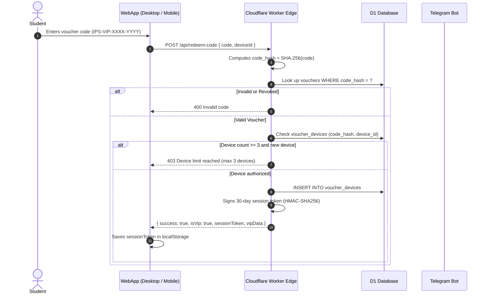

# IELTS Prep Studio (Open Academic Edition) — Complete Architectural Breakdown

**Version:** 8.8 (Open Academic & Kinetic Speak Edition)  
**Target Milestone:** Band 7.5 to 8.5+ IELTS Academic & General Practice  
**Live Web Application (PWA):** [https://hugokami.github.io/ielts-prep-studio/](https://hugokami.github.io/ielts-prep-studio/)  
**Telegram Mini App & Bot:** [@IELTSPrepStudioBot](https://t.me/IELTSPrepStudioBot)  
**Edge Backend Infrastructure:** Cloudflare Worker Edge (`ielts-prep-studio-backend.lyan123-lh.workers.dev`)  
**Database Engines:** Cloudflare D1 (Serverless SQLite) + Cloudflare KV + Firebase Firestore (`firestore.rules` v2)  
**Serverless AI Pipeline:** Cloudflare Workers AI (`@cf/meta/llama-3.2-3b-instruct` / `@cf/meta/llama-3.1-8b-instruct`) ➔ Multi-tier failover  
**Cache Manifest:** `ielts-prep-studio-v8.8` (Offline Service Worker PWA)  
**Content Provenance:** Audited & verified original (see [CONTENT_SOURCES.md](CONTENT_SOURCES.md))  

---

## 1. Executive Summary & Legal Disclaimers

**IELTS Prep Studio** is an all-in-one preparation ecosystem engineered to support scholars preparing for the IELTS examination. Operating seamlessly across desktop/mobile web browsers and within Telegram, the studio pairs authentic computer-delivered testing (CBT) simulations with automated criteria-referenced AI evaluations, spaced-repetition flashcards, and live academic tools.

### Trademark & Non-Affiliation Notice
> *IELTS is a registered trademark of the University of Cambridge, the British Council, and IDP Education Australia. IELTS Prep Studio is an independent educational platform and is not affiliated with, approved, or endorsed by Cambridge Assessment English, the British Council, or IDP Education.*

### AI Practice Notice
> *Automated AI evaluations provide estimated diagnostic feedback based on publicly available IELTS band descriptors for practice purposes and are not official test scores.*

---

## 2. High-Level System Architecture

```mermaid
graph TD
    subgraph Client Layer
        BrowserPWA["🌐 Modern Desktop & Mobile Browsers (PWA)"]
        TelegramTMA["📱 Telegram Mini App (TMA WebApp)"]
        SW["⚡ Service Worker v8.8 (Offline Cache)"]
    end

    subgraph Edge Layer (Cloudflare Workers)
        CFWorker["☁️ Cloudflare Worker Backend Router"]
        D1DB[("🗄️ Cloudflare D1 Database (SQLite)")]
        CFKV[("⚡ Cloudflare KV (Rate-Limiting & Quota)")]
        EdgeAI["🧠 Cloudflare Workers AI (Llama 3.2 3B / 3.1 8B)"]
    end

    subgraph External & Automation
        TGBotAPI["🤖 Telegram Bot API (@IELTSPrepStudioBot)"]
        GSheetsWebhook["📊 Google Sheets Auto-Sync Webhook"]
        FirestoreDB[("🔥 Cloud Firestore (Sync & Vouchers)")]
    end

    BrowserPWA --> SW
    BrowserPWA --> CFWorker
    TelegramTMA --> CFWorker
    CFWorker --> D1DB
    CFWorker --> CFKV
    CFWorker --> EdgeAI
    CFWorker --> TGBotAPI
    CFWorker --> GSheetsWebhook
    BrowserPWA -.-> FirestoreDB
```

---

## 3. Seven Core Study Hubs (Detailed Breakdown)

### Hub 1: Overview & Cirrus Daylight Hero
* **Personalized Scholar Presence**: Automatically detects authenticated profile (Google or Telegram) and displays the user's avatar image within `.uiv-avatar-wrap` alongside a live green presence pulse ring (`.uiv-avatar-pulse`). Dynamically personalizes the greeting to *"Welcome back, [First Name]"*.
* **Kinetic Typography (`decrypted-text`)**: Built with Motion-Anything and OpenDesign standards. The hero headline (*"Master Cambridge-style IELTS on a quieter kind of preparation."*) and scholar greeting scramble through `!<>-_\/[]{}=+*^?#` on page load, hover, and touch, smoothly resolving at 38ms intervals. Cycles in a gentle, staggered loop (every 7.5s–9.5s) that automatically suspends when the tab is inactive or hidden.
* **Ambient CTA Glow (`star-border`)**: Action buttons utilize a 360° GPU-accelerated rotating gradient glow traveling around the button perimeter without freezing in mobile WebKit.
* **Tactile 3-Bar Settings Control**: Custom lavender-purple toggle button featuring interactive slider tracks with animated sliding thumb beads that transition on hover and tap.
* **5-Pillar Readiness Radar**: Visual SVG diagnostic telemetry scoring readiness across Task Achievement, Coherence & Cohesion, Lexical Resource, Grammatical Range, and Fluency.

### Hub 2: Academic Lexicon & Leitner SRS Flashcards
* **Curriculum Scale**: 1,162 verified C1/C2 Academic vocabulary items and collocations (250 core words in Free Tier, 1,162 unlocked in VIP Pass).
* **1-3-7 Leitner SRS Engine**: Spaced repetition tracking across 5 mastery boxes (Box 1: Daily, Box 2: 3-Day, Box 3: 7-Day, Box 4: 14-Day, Box 5: Mastered).
* **Bilingual English/Burmese Support**: Real-time language toggle displaying pronunciation (IPA), register notes, definitions, example sentences, and contextual Burmese glosses.
* **Quick Search Drawer (⌘K / Ctrl+K)**: Instant search indexing terms, phonetic spellings, synonyms, and collocations.

### Hub 3: IELTS-Style Reading CBT Simulation (100% Free)
* **23 Complete CBT Passages (100% Free)**: 231 practice questions across Passages 1–8 (Mini Skill Drills, 2–7 questions) and Passages 9–23 (Full-Length Academic Passages, 13–14 questions).
* **Authentic Computer-Delivered Interface**: Split-screen design with adjustable split ratio between the passage pane and interactive question sheet.
* **Question Typology**:
  * True / False / Not Given & Yes / No / Not Given
  * Matching Headings & Information Location
  * Summary Completion & Table Completion
  * Multiple Choice & Sentence Completion
* **Exam Controls**: 60-minute countdown timer, question navigator grid, and instant raw-score-to-band conversion.

### Hub 4: Academic Writing Task 1 & Task 2 Suite
* **40 High-Scoring Model Essays**: Visual data models for Task 1 (bar charts, line graphs, process diagrams, maps) and discursive essays for Task 2 (5 model essays in Free Tier, 40 models in VIP Pass).
* **Live Word Counter & Draft Autosave**: Automatically persists essay drafts to `localStorage` and synchronized cloud storage with zero keystroke latency.
* **CEFR 90/10 AI Practice Evaluator**: Analytical scoring referenced against official IELTS writing band descriptors (Task Achievement, Coherence & Cohesion, Lexical Resource, Grammatical Accuracy) with sentence-level native rewrites (5 monthly checks in Free Tier, 60 monthly checks in VIP Pass).

### Hub 5: Speaking Assistant & Practice Simulator
* **Part 1, 2 & 3 Practice Simulator**: 30 seasonal practice topics with built-in 1-minute prep timer and 2-minute response timer.
* **5 Speaking Frameworks**: Interactive response structuring using PREP (Point, Reason, Example, Point), STAR, PEEP, Cause-Effect, and Past-Present-Future timelines.
* **Zero-Mic Browser Speech Transcriber**: Live speech recognition stream matching recording playback in real time without audio permission collisions (10 evaluations/month in Free Tier, Unlimited in VIP Pass).

### Hub 6: High-Yield Academic AI Tools
* **Collocations Engine (`/collocate`)**: Instant contextual pairings for academic keywords.
* **Academic Paraphraser & Synonyms (`/syn`)**: Replaces repetitive phrasing with C1/C2 academic register alternatives.
* **Live Academic Dictionary (`/dict`)**: Formal definitions, register classifications, and usage warnings.
* **Interactive Band Score Calculator & Exam Countdown**: Personalized countdown clock targeting candidate exam dates.

### Hub 7: AI Practice Mentor & In-App Copilot
* **Full-Page Borderless Interface**: Minimalist canvas with floating message bubbles and prompt suggestion chips.
* **Animated Liquid Morphing Orb**: Animated SVG/CSS liquid morphing logo with three rotating hexagonal clipping paths and contrast-blur filters.
* **Multi-Tier Serverless Failover**: Cloudflare Workers AI with fallback handling.

---

## 4. Free Plan vs. Lifetime VIP Studio Pass

| Preparation Dimension | Free Plan (Default Scholar) | Lifetime VIP Studio Pass (👑) | Codebase Enforcement |
| :--- | :--- | :--- | :--- |
| **Pricing & Term** | **0 MMK / $0 Free Forever** | **55,000 MMK** (one-time lifetime) or **750 ★ Telegram Stars** | Lifetime access, 0 recurring fees |
| **CBT Reading Passages** | **All 23 Passages (231 Questions) 100% Free** | **All 23 Passages (231 Questions) 100% Free** | Split-pane CBT, 60-min timer |
| **Academic Lexicon** | 250 Core Words | **1,162 Academic Items** + 1-3-7 Leitner Spaced Repetition | `data/lexicon.json` |
| **Writing Model Essays** | 5 Model Essays | **40 High-Scoring Model Essays** (All Task 1 & Task 2 categories) | Sentence-by-sentence analysis |
| **AI Writing Evaluations** | **5 checks / month** | **60 checks / month** (2 essays/day fair-use) | Edge KV Quota Enforcement |
| **AI Speaking Checks** | **10 checks / month** | **Unlimited AI Speech Evaluations** | Edge KV Quota Enforcement |
| **Speaking Topics** | 3 sample topics | **30 Practice Topics** (Parts 1, 2, 3 with 5 frameworks) | Unlocked in VIP Pass |
| **Paraphrasing Drills** | **10 drills / day** | **Unlimited Daily Drills** + Part 17 Cloze + Mistake History | Edge KV Quota Enforcement |
| **AI Practice Mentor** | **10 daily queries** (Edge tools) | **Unlimited Practice Queries** | Edge KV Quota Enforcement |
| **Device Access** | Single browser (`localStorage`) | **Multi-device cloud sync** (Telegram Mini App + Desktop PC/Mac) | Cloudflare D1 + KV + Firestore |
| **Desktop Activation** | Not available | **Personal Cryptographic Voucher** (`IPS-VIP-XXXX-YYYY`) | Max 3 devices per voucher hash |

---

## 5. Security, VIP Entitlement & Multi-Device Voucher Architecture



### Key Security Invariants
1. **Server-Side Authority**: Client state (`localStorage`, `tier === 'vip'`) is never trusted by Cloudflare Worker. Only cryptographically verified HMAC signatures from Telegram `initData` or verified session tokens grant VIP capabilities.
2. **Hashed Voucher Storage**: Voucher codes are stored in D1 as SHA-256 hashes (`code_hash`), protecting against database leak harvesting.
3. **Multi-Device Binding**: Vouchers are bound to a maximum of 3 concurrent devices in `voucher_devices`, preventing public account-sharing while allowing legitimate multi-device use (e.g. phone, laptop, iPad).
4. **Administrative Safety**: Customer data export is strictly executed inside private Telegram admin chats via `/export` or `/customers`. The insecure HTTP CSV endpoint has been completely decommissioned.
5. **CSV Formula Injection Sanitization**: All exported spreadsheet cells starting with `=`, `+`, `-`, `@`, `	`, or `
` are sanitized with a leading `'` before output.
6. **Telegram Webhook Verification**: All incoming webhooks must supply a valid `X-Telegram-Bot-Api-Secret-Token` matching `WEBHOOK_SECRET` via constant-time verification (`crypto.subtle.timingSafeEqual`).

---

## 6. Cloudflare D1 Database Schema

```sql
CREATE TABLE IF NOT EXISTS users (
  telegram_id INTEGER PRIMARY KEY,
  username TEXT,
  first_name TEXT,
  is_vip INTEGER DEFAULT 0,
  vip_activated_at INTEGER DEFAULT 0,
  srs_due_count INTEGER DEFAULT 0,
  exam_date TEXT,
  target_band REAL DEFAULT 7.5,
  progress_json TEXT DEFAULT '{}',
  pending_tool TEXT,
  preferred_lang TEXT DEFAULT 'en',
  updated_at INTEGER
);

CREATE TABLE IF NOT EXISTS payments (
  id INTEGER PRIMARY KEY AUTOINCREMENT,
  telegram_id INTEGER,
  username TEXT,
  file_id TEXT,
  caption_note TEXT,
  amount_mmk INTEGER DEFAULT 55000,
  stars_amount INTEGER DEFAULT 0,
  currency TEXT DEFAULT 'MMK',
  payment_method TEXT DEFAULT 'slip',
  stars_charge_id TEXT,
  status TEXT DEFAULT 'pending',
  created_at INTEGER
);

CREATE TABLE IF NOT EXISTS vouchers (
  code_hash TEXT PRIMARY KEY,
  telegram_id INTEGER,
  tier TEXT DEFAULT 'vip',
  max_devices INTEGER DEFAULT 3,
  revoked INTEGER DEFAULT 0,
  created_at INTEGER
);

CREATE TABLE IF NOT EXISTS voucher_devices (
  code_hash TEXT,
  device_id TEXT,
  first_seen INTEGER,
  PRIMARY KEY (code_hash, device_id)
);

CREATE TABLE IF NOT EXISTS daily_quota (
  telegram_id INTEGER,
  date_str TEXT,
  count INTEGER DEFAULT 0,
  PRIMARY KEY (telegram_id, date_str)
);
```

---

## 7. Motion-Anything Design System (`/open-design`)

| Recipe Name | Target Elements | Visual Expression & Technical Implementation |
| :--- | :--- | :--- |
| `shiny-text` | Streak titles, VIP badges, headers | Dynamic linear-gradient text-fill clip shimmering horizontally across headings. |
| `typewriter-multi` | Live telemetry box | Terminal-style multi-sentence typewriter cycling test metrics and study hints. |
| `star-border` | Hero action buttons | Hardware GPU-accelerated 360° rotating conic gradient with `isolation: isolate` and `inset: 2px` card backplate. |
| `rotating-text` | Dynamic collocation badges | Inline vertical word cycler transitioning through academic vocabulary categories. |
| `decrypted-text` | Hero headline & scholar greeting | Cybernetic character decrypting at 38ms/step with an organic 7.5s–9.5s slow continuous loop and tab-visibility detection. |
| Tactile Sliders | Settings button | Triple-bar toggle with smooth horizontal translating thumb beads responding to hover and touch states. |

---

## 8. Verification & Deployment Protocols

1. **Byte Parity Invariant**: Run SHA-256 hash checks on `index.html` and `ielts_prep_studio_open_academic_edition.html` before every deployment to ensure identical hashes.
2. **Service Worker Versioning**: Increment cache name in `sw.js` (`ielts-prep-studio-v8.8`) upon any asset modification.
3. **AST Graph Integrity**: Execute `python -m graphify update .` to keep graph structures current with 0 token overhead.
4. **Syntax Assurance**: Verify inline scripts via `node --check` across `index.html`, `backend/worker.js`, and `telegram-bot/bot.js`.
