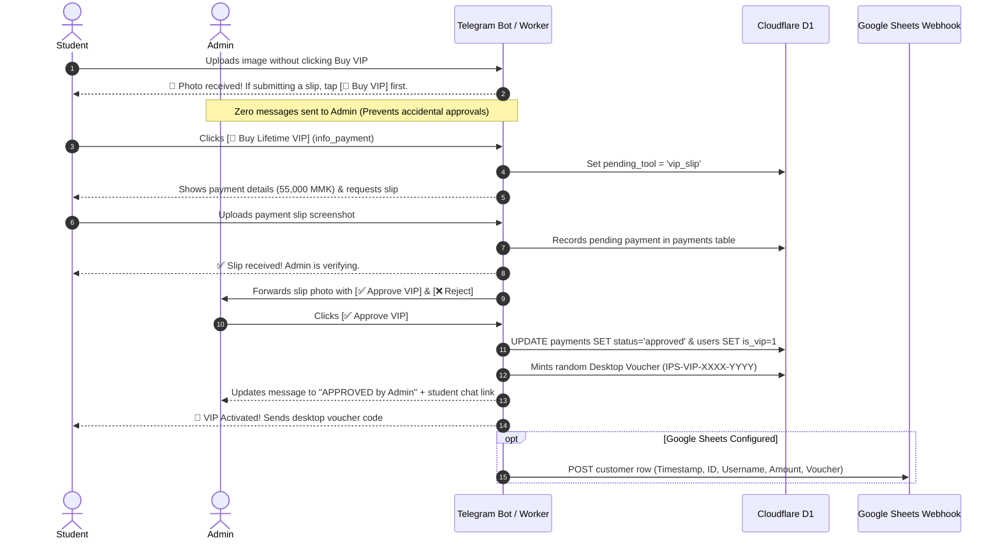

# IELTS Prep Studio (Open Academic Edition) — Complete Architectural Breakdown

**Version:** 8.7 (Open Academic & Kinetic Speak Edition)  
**Target Milestone:** Band 8.5+ Cambridge IELTS Academic & General Mastery  
**Live Web Application (PWA):** [https://hugokami.github.io/ielts-prep-studio/](https://hugokami.github.io/ielts-prep-studio/)  
**Telegram Mini App & Bot:** [@IELTSPrepStudioBot](https://t.me/IELTSPrepStudioBot)  
**Edge Backend Infrastructure:** Cloudflare Worker Edge (`ielts-prep-studio-backend.lyan123-lh.workers.dev`)  
**Database Engines:** Cloudflare D1 (Serverless SQLite) + Cloudflare KV + Firebase Firestore (`firestore.rules` v2)  
**Serverless AI Pipeline:** Cloudflare Workers AI (`@cf/meta/llama-3.2-3b-instruct`) ➔ Pollinations OpenAI Neural Core ➔ Perchance Keyless Engine ➔ High-Yield Local Fallback  
**Cache Manifest:** `ielts-prep-studio-v8.7` (Offline Service Worker PWA)  

---

## 1. Executive Summary & Vision

**IELTS Prep Studio** is an all-in-one, high-performance IELTS Academic and General Training preparation ecosystem. Designed to replace fragmented PDF textbooks, generic subscription platforms, and low-quality AI outputs, the studio delivers an authentic, computer-delivered IELTS (CBT) testing simulation paired with instantaneous, criteria-referenced automated evaluations.

### Core Pedagogical & Technical Tenets
1. **Cambridge Academic Rigor**: Zero tolerance for template fluff or generic AI slop (bans clichés like *"In a nutshell"* or *"First and foremost"*). Enforces Theme-Rheme information structure, modal hedging (*"Seldom do we consider..."*), and C1/C2 collocational precision.
2. **Dual-Environment Architecture**: Runs with 100% feature parity as an offline-capable Progressive Web App (PWA) on desktop/mobile browsers and as an embedded Telegram Mini App (TMA).
3. **Zero Developer Cost Serverless AI**: Primary AI evaluations run on Cloudflare Workers AI at the network edge with multi-tiered zero-cost fallbacks.
4. **Single-File Parity Invariant**: `index.html` and `ielts_prep_studio_open_academic_edition.html` maintain strict 100% byte-for-byte SHA-256 parity at all times.

---

## 2. High-Level System Architecture

```mermaid
graph TD
    subgraph Client Layer
        BrowserPWA["🌐 Modern Desktop & Mobile Browsers (PWA)"]
        TelegramTMA["📱 Telegram Mini App (TMA WebApp)"]
        SW["⚡ Service Worker v8.7 (Offline Cache)"]
    end

    subgraph Edge Layer (Cloudflare Workers)
        CFWorker["☁️ Cloudflare Worker Backend Router"]
        D1DB[("🗄️ Cloudflare D1 Database (SQLite)")]
        CFKV[("⚡ Cloudflare KV (Rate-Limiting & Quota)")]
        EdgeAI["🧠 Cloudflare Workers AI (Llama 3.2 3B)"]
    end

    subgraph External & Automation
        TGBotAPI["🤖 Telegram Bot API (@IELTSPrepStudioBot)"]
        GSheetsWebhook["📊 Google Sheets Auto-Sync Webhook"]
        FirestoreDB[("🔥 Cloud Firestore (Sync & Vouchers)")]
    end

    BrowserPWA --> SW
    BrowserPWA --> CFWorker
    TelegramTMA --> CFWorker
    CFWorker --> D1DB
    CFWorker --> CFKV
    CFWorker --> EdgeAI
    CFWorker --> TGBotAPI
    CFWorker --> GSheetsWebhook
    BrowserPWA -.-> FirestoreDB
```

---

## 3. Seven Core Study Hubs (Detailed Breakdown)

### Hub 1: Overview & Cirrus Daylight Hero
* **Personalized Scholar Presence**: Automatically detects authenticated profile (Google or Telegram) and displays the user's avatar image within `.uiv-avatar-wrap` alongside a live green presence pulse ring (`.uiv-avatar-pulse`). Dynamically personalizes the greeting to *"Welcome back, [First Name]"*.
* **Kinetic Typography (`decrypted-text`)**: Built with Motion-Anything and OpenDesign standards. The hero headline (*"Master Cambridge IELTS on a quieter kind of preparation."*) and scholar greeting scramble through `!<>-_\\/[]{}=+*^?#` on page load, hover, and touch, smoothly resolving at 38ms intervals. Cycles in a gentle, staggered loop (every 7.5s–9.5s) that automatically suspends when the tab is inactive or hidden to conserve hardware resources.
* **Ambient CTA Glow (`star-border`)**: Buttons such as *Start Daily Lesson →* and *Review SRS Flashcards ↗* utilize a 360° GPU-accelerated rotating gradient glow traveling around the button perimeter without freezing in mobile WebKit.
* **Tactile 3-Bar Settings Control**: Custom lavender-purple toggle button featuring interactive slider tracks with animated sliding thumb beads that transition on hover and tap to open the settings drawer.
* **5-Pillar Readiness Radar**: Visual SVG diagnostic telemetry scoring readiness across Task Achievement, Coherence & Cohesion, Lexical Resource, Grammatical Range, and Fluency.

### Hub 2: Academic Lexicon & Leitner SRS Flashcards
* **Curriculum Scale**: 1,162 verified C1/C2 Academic vocabulary items and collocations aligned with the Oxford 3000/5000 and Cambridge IELTS Academic Word Lists.
* **1-3-7 Leitner SRS Engine**: Spaced repetition tracking across 5 mastery boxes (Box 1: Daily, Box 2: 3-Day, Box 3: 7-Day, Box 4: 14-Day, Box 5: Mastered).
* **Bilingual English/Burmese Support**: Real-time language toggle displaying pronunciation (IPA), register notes, definitions, example sentences, and contextual Burmese glosses.
* **Quick Search Drawer (⌘K / Ctrl+K)**: Instant search indexing terms, phonetic spellings, synonyms, and collocations.

### Hub 3: Cambridge Reading CBT Simulation
* **23 Full-Length CBT Passages**: 231 examiner-grade reading questions across genuine academic topics (climate science, behavioral economics, biotechnology, archaeology).
* **Authentic Computer-Delivered Interface**: Split-screen design with adjustable split ratio between the passage pane and the interactive question pane.
* **Question Typology**:
  * True / False / Not Given & Yes / No / Not Given
  * Matching Headings & Information Location
  * Summary Completion & Table Completion
  * Multiple Choice & Sentence Completion
* **Exam Controls**: 60-minute countdown timer, question review navigator bar with flag/review indicators, and instant score conversion to IELTS 9-band scale.

### Hub 4: Academic Writing Task 1 & Task 2 Suite
* **40 Band 9 Model Essays**: Visual data models for Task 1 (bar charts, line graphs, process diagrams, cartographic maps) and argumentative essays for Task 2.
* **Live Word Counter & Draft Autosave**: Automatically persists essay drafts to `localStorage` and synchronized cloud storage with zero keystroke latency.
* **CEFR 90/10 AI Evaluator**: Comprehensive scoring against the official Cambridge IELTS writing band descriptors (Task Achievement, Coherence, Lexical Resource, Grammatical Accuracy).

### Hub 5: Speaking Assistant & Forecast Simulator
* **Part 1, 2 & 3 Cue Card Simulator**: 30 seasonal forecast topics with built-in 1-minute prep timer and 2-minute response timer.
* **5 Speaking Frameworks**: Interactive response structuring using PREP (Point, Reason, Example, Point), STAR, PEEP, Cause-Effect, and Past-Present-Future timelines.
* **Zero-Mic Browser Speech Transcriber**: Live speech recognition stream matching recording playback in real time without audio permission collisions.

### Hub 6: High-Yield Academic AI Tools
* **Collocations Engine (`/collocate`)**: Instant contextual pairings for academic keywords.
* **Academic Paraphraser & Synonyms (`/syn`)**: Replaces repetitive phrasing with C1/C2 academic register alternatives.
* **Live Academic Dictionary (`/dict`)**: Formal definitions, register classifications, and usage warnings.
* **Interactive Band Score Calculator & Exam Countdown**: Personalized countdown clock targeting candidate exam dates.

### Hub 7: Cambridge AI Mentor & In-App Copilot
* **Full-Page Borderless Interface**: Google Gemini-style minimalist canvas with floating message bubbles and prompt suggestion chips.
* **Cambridge Liquid Morphing Orb**: Animated SVG/CSS liquid morphing logo with three rotating hexagonal clipping paths and contrast-blur filters.
* **Spectrum Loading State**: Four-bar kinetic equalizer animating while responses generate.
* **Four-Tier Failover Pipeline**:
  1. Primary: Cloudflare Workers AI (`@cf/meta/llama-3.2-3b-instruct`).
  2. Secondary: Pollinations OpenAI Neural Core.
  3. Tertiary: Perchance Async Keyless Generation Engine.
  4. Quaternary: High-Yield Local Academic Cache.

---

## 4. Telegram Bot & Mini App Integration

### Architecture & BotFather Configuration
* **Bot Username**: `@IELTSPrepStudioBot`
* **Mini App Menu Button**: Bound directly via BotFather to `https://hugokami.github.io/ielts-prep-studio/` via `[ ▭ Open App ]` persistent button.
* **Direct WebApp Link**: `t.me/IELTSPrepStudioBot/IELTS`

### Telegram Commands
| Command | Role | Description |
| :--- | :--- | :--- |
| `/start` | Public | Launches interactive menu, checks VIP status, and provides launch button |
| `/exam` | Public | Sets or inspects target IELTS exam countdown |
| `/collocate <word>` | Public / VIP | Queries academic collocations |
| `/syn <word>` | Public / VIP | Generates Band 8.5+ paraphrases |
| `/dict <word>` | Public / VIP | Looks up academic dictionary definitions |
| `/read <topic>` | Public / VIP | Generates cloze reading passage drills |
| `/tip` | Public | Delivers daily Cambridge Band 9 strategies |
| `/pay` or `/vip` | Public | Initiates VIP checkout flow and instructions |
| `/stats` or `/admin` | Admin Only | Displays executive financial, student base, and voucher metrics |
| `/export` or `/customers` | Admin Only | Compiles and delivers live customer spreadsheet (`.csv`) in chat |
| `/lookup <user>` | Admin Only | Inspects student database profile and status |
| `/vip <id> on/off` | Admin Only | Manually toggles VIP access for any user |

---

## 5. VIP Monetization, Slip Safeguard & Automated Spreadsheets

### Pricing Architecture
* **Myanmar Local Payment**: **55,000 MMK** (one-time lifetime access) via KBZPay / WavePay (`09-768691939` Lyan Htet).
* **Worldwide Instant Checkout**: **750 ★ Telegram Stars** (`XTR`) with automated edge verification.

### Slip Upload Safeguard Flow


### Customer Spreadsheet Export & Sync Methods
1. **Telegram Chat Command (`/export`, `/customers`, `/csv`)**: Instantly compiles and sends `ielts_vip_customers_YYYY-MM-DD.csv` (UTF-8 BOM) directly into the admin's Telegram chat.
2. **Dashboard Button**: One-tap `[ 📥 Download Customers Spreadsheet (.csv) ]` button inside `/stats`.
3. **Automated Google Sheets Webhook**: Background asynchronous POST (`ctx.waitUntil`) on every approval directly to `GOOGLE_SHEETS_WEBHOOK_URL`.
4. **Browser Direct Download**: Accessible via `https://ielts-prep-studio-backend.lyan123-lh.workers.dev/api/admin/customers.csv?key=<ADMIN_ID>`.

---

## 6. Motion-Anything Design System (`/open-design`)

| Recipe Name | Target Elements | Visual Expression & Technical Implementation |
| :--- | :--- | :--- |
| `shiny-text` | Streak titles, VIP badges, headers | Dynamic linear-gradient text-fill clip shimmering horizontally across headings. |
| `typewriter-multi` | Live telemetry box | Terminal-style multi-sentence typewriter cycling Cambridge test metrics and study hints. |
| `star-border` | Hero action buttons | Hardware GPU-accelerated 360° rotating conic gradient with `isolation: isolate` and `inset: 2px` card backplate. |
| `rotating-text` | Dynamic collocation badges | Inline vertical word cycler transitioning through academic vocabulary categories. |
| `decrypted-text` | Hero headline & scholar greeting | Cybernetic character decrypting at 38ms/step with an organic 7.5s–9.5s slow continuous loop and tab-visibility detection. |
| Tactile Sliders | Settings button | Triple-bar toggle with smooth horizontal translating thumb beads responding to hover and touch states. |

---

## 7. Cloudflare D1 Database Schema

```sql
CREATE TABLE IF NOT EXISTS users (
  telegram_id INTEGER PRIMARY KEY,
  username TEXT,
  first_name TEXT,
  is_vip INTEGER DEFAULT 0,
  vip_activated_at INTEGER DEFAULT 0,
  srs_due_count INTEGER DEFAULT 0,
  exam_date TEXT,
  target_band REAL DEFAULT 7.5,
  progress_json TEXT DEFAULT '{}',
  pending_tool TEXT,
  preferred_lang TEXT DEFAULT 'en',
  updated_at INTEGER
);

CREATE TABLE IF NOT EXISTS payments (
  id INTEGER PRIMARY KEY AUTOINCREMENT,
  telegram_id INTEGER,
  username TEXT,
  file_id TEXT,
  caption_note TEXT,
  amount_mmk INTEGER DEFAULT 55000,
  stars_amount INTEGER DEFAULT 0,
  currency TEXT DEFAULT 'MMK',
  payment_method TEXT DEFAULT 'slip',
  stars_charge_id TEXT,
  status TEXT DEFAULT 'pending',
  created_at INTEGER
);

CREATE TABLE IF NOT EXISTS promo_codes (
  code TEXT PRIMARY KEY,
  is_used INTEGER DEFAULT 0,
  used_by_tg_id INTEGER,
  used_at INTEGER
);

CREATE TABLE IF NOT EXISTS daily_quota (
  telegram_id INTEGER,
  date_str TEXT,
  count INTEGER DEFAULT 0,
  PRIMARY KEY (telegram_id, date_str)
);
```

---

## 8. Verification & Deployment Protocols

1. **Byte Parity Invariant**: Run SHA-256 hash checks on `index.html` and `ielts_prep_studio_open_academic_edition.html` before every deployment to ensure identical hashes.
2. **Service Worker Versioning**: Increment cache name in `sw.js` (e.g. `ielts-prep-studio-v8.7`) upon any asset modification.
3. **AST Graph Integrity**: Execute `python -m graphify update .` to keep graph structures current with 0 token overhead.
4. **Syntax Assurance**: Verify inline scripts via `node --check` across `index.html`, `backend/worker.js`, and `telegram-bot/bot.js`.
